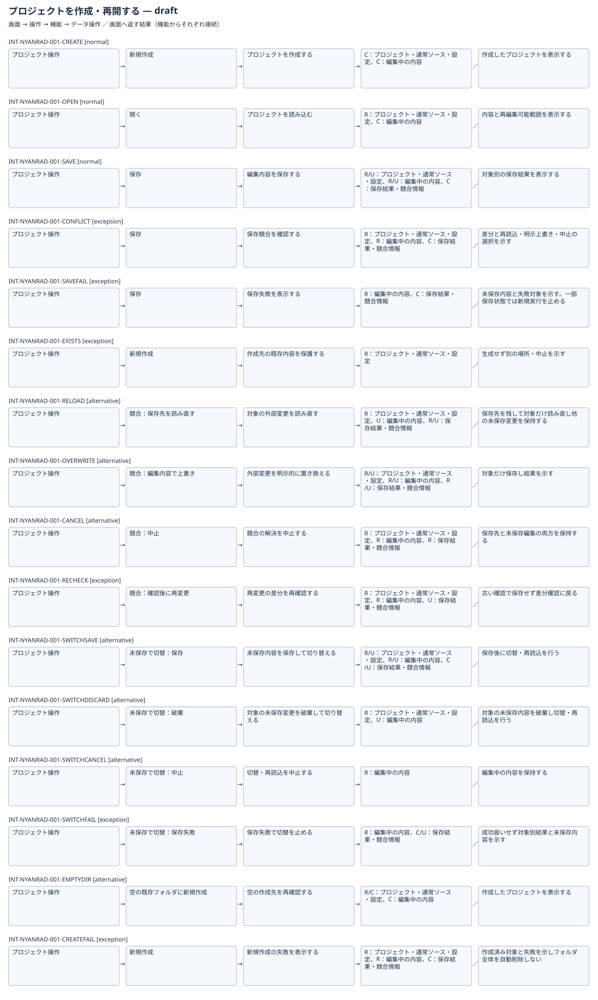

# プロジェクトを作成・再開する：IFDAM確認用初稿

| Interaction | 種別 | 条件 | 返す結果 |
|---|---|---|---|
| INT-NYANRAD-001-CREATE | normal | 作成先に既存ファイルがない | 作成したプロジェクトを表示する |
| INT-NYANRAD-001-OPEN | normal | 対象ソースを読み込める | 内容と再編集可能範囲を表示する |
| INT-NYANRAD-001-SAVE | normal | 競合がなく保存できる | 対象別の保存結果を表示する |
| INT-NYANRAD-001-CONFLICT | exception | 外部で対象が変更された | 差分と再読込・明示上書き・中止の選択を示す |
| INT-NYANRAD-001-SAVEFAIL | exception | 全部または一部の保存が失敗 | 未保存内容と失敗対象を保持して表示し新規実行を止める |
| INT-NYANRAD-001-EXISTS | exception | 作成先に既存ファイルがある | 生成せず別の場所・中止を示す |
| INT-NYANRAD-001-RELOAD | alternative | 差分を確認し対象の未保存変更の破棄を承認 | 保存先を残して対象だけ読み直し他の未保存変更を保持する |
| INT-NYANRAD-001-OVERWRITE | alternative | 対象と外部変更の置換を明示確認し確認後の再変更がない | 対象だけ保存し結果を示す |
| INT-NYANRAD-001-CANCEL | alternative | 競合画面で中止 | 保存先と未保存編集の両方を保持する |
| INT-NYANRAD-001-RECHECK | exception | 利用者の判断後に保存先が変わった | 古い確認で保存せず差分確認に戻る |
| INT-NYANRAD-001-SWITCHSAVE | alternative | 未保存で切替時に保存を選び保存に成功 | 保存後に切替・再読込を行う |
| INT-NYANRAD-001-SWITCHDISCARD | alternative | 未保存で切替時に破棄を選択 | 対象の未保存内容を破棄し切替・再読込を行う |
| INT-NYANRAD-001-SWITCHCANCEL | alternative | 未保存で切替時に中止 | 編集中の内容を保持する |
| INT-NYANRAD-001-SWITCHFAIL | exception | 切替前の保存が失敗 | 成功扱いせず対象別結果と未保存内容を示す |
| INT-NYANRAD-001-EMPTYDIR | alternative | 作成先が存在するが空であり生成直前に再確認できた | 作成したプロジェクトを表示する |
| INT-NYANRAD-001-CREATEFAIL | exception | 作成途中で失敗した | 作成済み対象と失敗を示しフォルダ全体を自動削除しない |

検討中の部分集合。未実証の技術成立や提供条件を含み、正式候補・Baseline・実装開始は未成立。DB動作やIDE外実行の検証組合せは[網羅性確認表](../coverage-review.md)で追跡。
