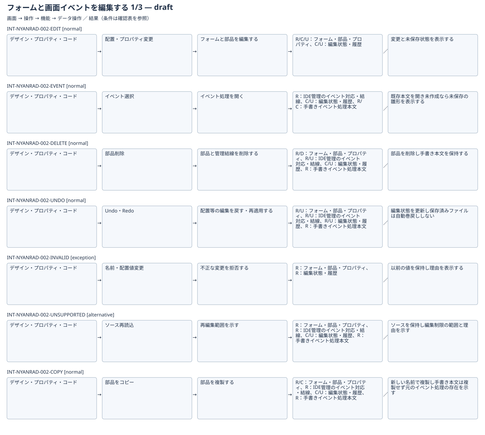
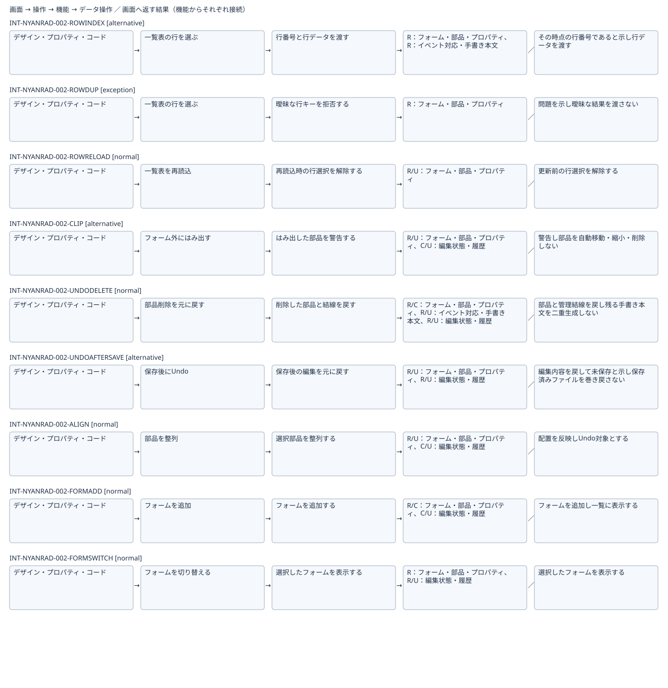

# フォームと画面イベントを編集する：IFDAM確認用初稿

[全体図](flow.svg)（分割図の重複行は見切れ防止のため）

各処理のIDを選ぶと、開始画面・操作・機能・データ・結果・終了画面を示す個別図を開けます。条件は下表をご覧ください。

| Interaction | 種別 | 条件 | 返す結果 |
|---|---|---|---|
| [INT-NYANRAD-002-EDIT](diagrams/01.svg) | normal | 入力が有効 | 変更と未保存状態を表示する |
| [INT-NYANRAD-002-EVENT](diagrams/02.svg) | normal | 対象イベントを選択 | 既存本文または初回の雛形を開く |
| [INT-NYANRAD-002-DELETE](diagrams/03.svg) | normal | 対象部品を選択 | 部品を削除し手書き本文を保持する |
| [INT-NYANRAD-002-UNDO](diagrams/04.svg) | normal | 対象操作の履歴がある | 編集状態を更新し保存済みファイルは自動巻戻ししない |
| [INT-NYANRAD-002-INVALID](diagrams/05.svg) | exception | 名前重複・規則違反・不正な座標等 | 以前の値を保持し理由を表示する |
| [INT-NYANRAD-002-UNSUPPORTED](diagrams/06.svg) | alternative | 非対応または解析できない表現がある | ソースを保持し編集制限の範囲と理由を示す |
| [INT-NYANRAD-002-COPY](diagrams/07.svg) | normal | 対象部品を選択 | 新しい名前で複製し手書き本文は複製せず元のイベント処理の存在を示す |
| [INT-NYANRAD-002-RENAME](diagrams/08.svg) | normal | 有効で重複しない識別名を入力 | 管理対象を更新し手書き本文への影響を示す。本文は無条件に文字列置換しない |
| [INT-NYANRAD-002-ROWKEY](diagrams/09.svg) | normal | 行キーが指定済みで欠落・重複しない | キーとその時点の行データを渡す |
| [INT-NYANRAD-002-ROWINDEX](diagrams/10.svg) | alternative | 行キーが未指定 | その時点の行番号であると示し行データを渡す |
| [INT-NYANRAD-002-ROWDUP](diagrams/11.svg) | exception | 指定行キーが欠落または重複 | 問題を示し曖昧な結果を渡さない |
| [INT-NYANRAD-002-ROWRELOAD](diagrams/12.svg) | normal | 一覧表を再読込 | 更新前の行選択を解除する |
| [INT-NYANRAD-002-CLIP](diagrams/13.svg) | alternative | 配置またはフォーム寸法の変更で部品が外へ出る | 警告し部品を自動移動・縮小・削除しない |
| [INT-NYANRAD-002-UNDODELETE](diagrams/14.svg) | normal | 部品削除がUndoの対象である | 部品と管理結線を戻し残る手書き本文を二重生成しない |
| [INT-NYANRAD-002-UNDOAFTERSAVE](diagrams/15.svg) | alternative | 同じ編集セッションで保存後に対象操作をUndo | 編集内容を戻して未保存と示し保存済みファイルを巻き戻さない |
| [INT-NYANRAD-002-ALIGN](diagrams/16.svg) | normal | 整列対象を選択し基準を指定 | 配置を反映しUndo対象とする |
| [INT-NYANRAD-002-FORMADD](diagrams/17.svg) | normal | 有効で重複しないフォーム名を入力 | フォームを追加し一覧に表示する |
| [INT-NYANRAD-002-FORMSWITCH](diagrams/18.svg) | normal | 対象フォームを選択 | 選択したフォームを表示する |

検討中の部分集合。未実証の技術成立や提供条件を含み、正式候補・Baseline・実装開始は未成立。DB動作やIDE外実行の検証組合せは[網羅性確認表](../coverage-review.md)で追跡。
