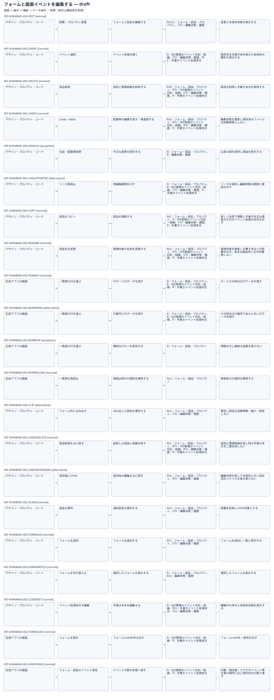

# フォームと画面イベントを編集する：IFDAM確認用初稿

| Interaction | 種別 | 条件 | 返す結果 |
|---|---|---|---|
| INT-NYANRAD-002-EDIT | normal | 入力が有効 | 変更と未保存状態を表示する |
| INT-NYANRAD-002-EVENT | normal | 対象イベントを選択 | 既存本文または初回の雛形を開く |
| INT-NYANRAD-002-DELETE | normal | 対象部品を選択 | 部品を削除し手書き本文を保持する |
| INT-NYANRAD-002-UNDO | normal | 対象操作の履歴がある | 編集状態を更新し保存済みファイルは自動巻戻ししない |
| INT-NYANRAD-002-INVALID | exception | 名前重複・規則違反・不正な座標等 | 以前の値を保持し理由を表示する |
| INT-NYANRAD-002-UNSUPPORTED | alternative | 非対応または解析できない表現がある | ソースを保持し編集制限の範囲と理由を示す |
| INT-NYANRAD-002-COPY | normal | 対象部品を選択 | 新しい名前で部品を複製し手書き処理本文を自動複製しない |
| INT-NYANRAD-002-RENAME | normal | 有効で重複しない識別名を入力 | 管理対象の対応を更新し手書き本文を無条件に文字列置換しない |
| INT-NYANRAD-002-ROWKEY | normal | 行キーが指定済みで欠落・重複しない | キーとその時点の行データを渡す |
| INT-NYANRAD-002-ROWINDEX | alternative | 行キーが未指定 | その時点の行番号であると示し行データを渡す |
| INT-NYANRAD-002-ROWDUP | exception | 指定行キーが欠落または重複 | 問題を示し曖昧な結果を渡さない |
| INT-NYANRAD-002-ROWRELOAD | normal | 一覧表を再読込 | 更新前の行選択を解除する |
| INT-NYANRAD-002-CLIP | alternative | 配置またはフォーム寸法の変更で部品が外へ出る | 警告し部品を自動移動・縮小・削除しない |
| INT-NYANRAD-002-UNDODELETE | normal | 部品削除がUndoの対象である | 部品と管理結線を戻し残る手書き本文を二重生成しない |
| INT-NYANRAD-002-UNDOAFTERSAVE | alternative | 同じ編集セッションで保存後に対象操作をUndo | 編集内容を戻して未保存と示し保存済みファイルを巻き戻さない |
| INT-NYANRAD-002-ALIGN | normal | 整列対象を選択し基準を指定 | 配置を反映しUndo対象とする |

検討中の部分集合。未実証の技術成立や提供条件を含み、正式候補・Baseline・実装開始は未成立。DB動作やIDE外実行の検証組合せは[網羅性確認表](../coverage-review.md)で追跡。
