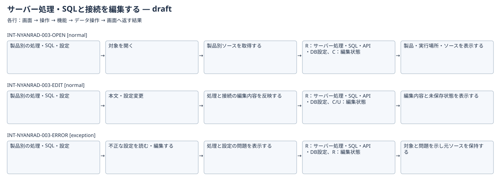

# サーバー処理・SQLと接続を編集する：IFDAM確認用初稿

| Interaction | 種別 | 条件 | 返す結果 |
|---|---|---|---|
| INT-NYANRAD-003-OPEN | normal | 対象を読み込める | 製品・実行場所・ソースを表示する |
| INT-NYANRAD-003-EDIT | normal | 編集可能な対象を開いている | 編集内容と未保存状態を表示する |
| INT-NYANRAD-003-ERROR | exception | 設定不正・非対応表現等 | 対象と問題を示し元ソースを保持する |

UI工程のWorkset候補を使用。正式な境界・Baselineは未成立。図は同じ構造化データから生成したSVGとMermaidソースを併記。Schema適合と要件の承認は別。
各行の条件と結果、データ操作は検討用。競合の各選択や細かな編集操作等をすべて分解した完全なInteraction一覧ではない。次の範囲確認で補完する。
