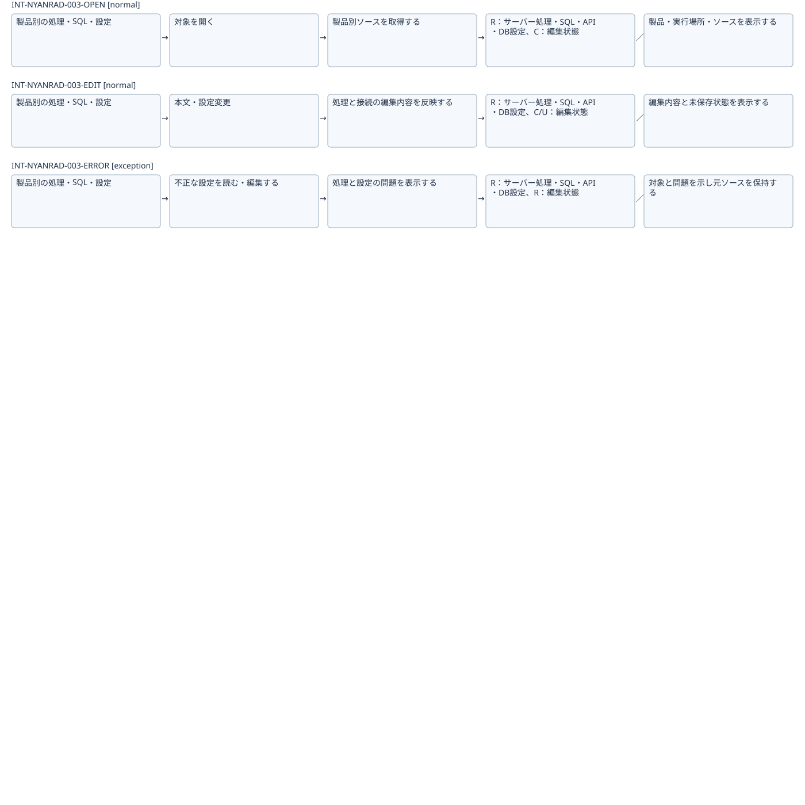

# サーバー処理・SQLと接続を編集する：IFDAM確認用初稿

[全体図](flow.svg)（分割図の重複行は見切れ防止のため）

| Interaction | 種別 | 条件 | 返す結果 |
|---|---|---|---|
| INT-NYANRAD-003-OPEN | normal | 対象を読み込める | 製品・実行場所・ソースを表示する |
| INT-NYANRAD-003-EDIT | normal | 編集可能な対象を開いている | 編集内容と未保存状態を表示する |
| INT-NYANRAD-003-ERROR | exception | 設定不正・非対応表現等 | 対象と問題を示し元ソースを保持する |

検討中の部分集合。未実証の技術成立や提供条件を含み、正式候補・Baseline・実装開始は未成立。DB動作やIDE外実行の検証組合せは[網羅性確認表](../coverage-review.md)で追跡。
