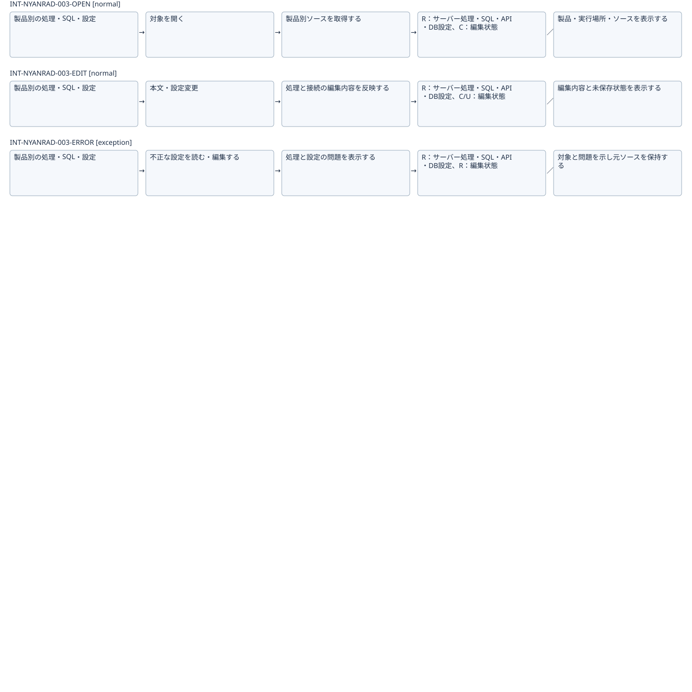

# サーバー処理・SQLと接続を編集する：IFDAM確認用初稿

[全体図](flow.svg)（分割図の重複行は見切れ防止のため）

各処理のIDを選ぶと、開始画面・操作・機能・データ・結果・終了画面を示す個別図を開けます。条件は下表をご覧ください。

| Interaction | 種別 | 条件 | 返す結果 |
|---|---|---|---|
| [INT-NYANRAD-003-OPEN](diagrams/01.svg) | normal | 対象を読み込める | 製品・実行場所・ソースを表示する |
| [INT-NYANRAD-003-EDIT](diagrams/02.svg) | normal | 編集可能な対象を開いている | 編集内容と未保存状態を表示する |
| [INT-NYANRAD-003-ERROR](diagrams/03.svg) | exception | 設定不正・非対応表現等 | 対象と問題を示し元ソースを保持する |

検討中の部分集合。未実証の技術成立や提供条件を含み、正式候補・Baseline・実装開始は未成立。DB動作やIDE外実行の検証組合せは[網羅性確認表](../coverage-review.md)で追跡。

関連する既存の編集条件・データの区別は[編集条件の補足](../editing-conditions-review.md)を参照。フォームLoad等の未表現の流れも同補足で追跡する。

## 確認表と併せて読む編集・接続条件

[機能検討](../../requirements/09-functions.md)と[DB範囲](../../requirements/17-database-scope.md)では、Nyan8のサーバー処理、NyanQLのSQL・API・DB設定を扱い、NyanPUIからNyanQLへ直接接続する構成と、Nyan8を経由する構成を区別する。プロジェクトごとに必要な製品を使用する。

編集内容と保存済みソースを区別する。SQLiteを既定とし、SQLite・DuckDBの各DBと両接続経路で基本CRUDを確認する方針だが、４組の動作確認は未実施。各製品・設定の具体的な編集条件、エラー時の詳細、実行結果の確認は残る。編集表示をDB処理の成功と読み替えない。

上記は既存要件を確認するための補足。個別図には各DBや接続経路の詳細をすべて表示していない。
