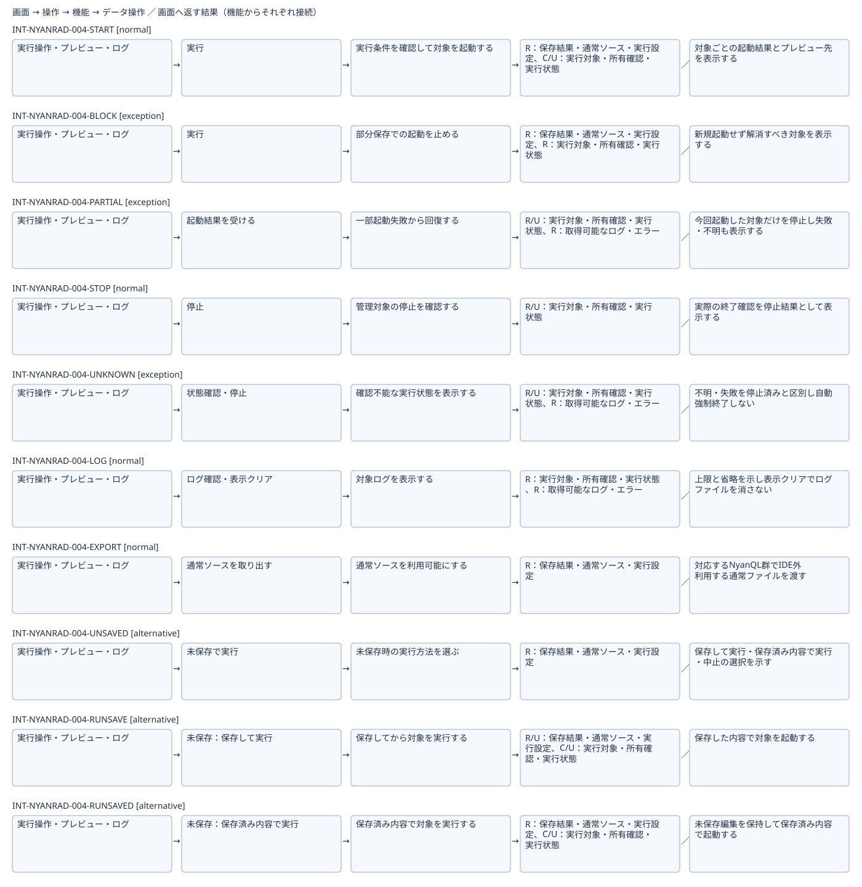
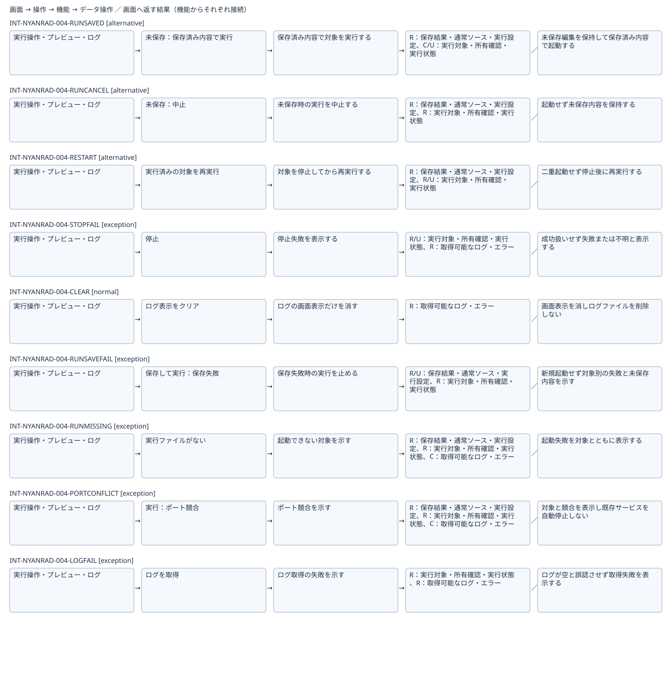

# アプリを実行して動作を確認する：IFDAM確認用初稿

[全体図](flow.svg)（分割図の重複行は見切れ防止のため）

| Interaction | 種別 | 条件 | 返す結果 |
|---|---|---|---|
| INT-NYANRAD-004-START | normal | 部分保存がなく未保存時の選択を解決し二重起動でない | 対象ごとの起動結果とプレビュー先を表示する |
| INT-NYANRAD-004-BLOCK | exception | 保存内容が部分保存で混在 | 新規起動せず解消すべき対象を表示する |
| INT-NYANRAD-004-PARTIAL | exception | 今回起動したサービスの一部が失敗 | 今回起動した対象だけを停止し失敗・不明も表示する |
| INT-NYANRAD-004-STOP | normal | 管理対象の所有を確認できる | 実際の終了確認を停止結果として表示する |
| INT-NYANRAD-004-UNKNOWN | exception | 所有・終了を確認できない | 不明・失敗を停止済みと区別し自動強制終了しない |
| INT-NYANRAD-004-LOG | normal | 対象からログを取得できる | 上限と省略を示し表示クリアでログファイルを消さない |
| INT-NYANRAD-004-EXPORT | normal | 対象の保存済み内容を確認できる | 対応するNyanQL群でIDE外利用する通常ファイルを渡す |
| INT-NYANRAD-004-UNSAVED | alternative | 未保存変更がある | 保存して実行・保存済み内容で実行・中止の選択を示す |
| INT-NYANRAD-004-RUNSAVE | alternative | 保存して実行を選び保存が成功 | 保存した内容で対象を起動する |
| INT-NYANRAD-004-RUNSAVED | alternative | 保存済み内容で実行を選択し部分保存でない | 未保存編集を保持して保存済み内容で起動する |
| INT-NYANRAD-004-RUNCANCEL | alternative | 中止を選択 | 起動せず未保存内容を保持する |
| INT-NYANRAD-004-RESTART | alternative | 同じ対象が実行済みで停止完了を確認 | 二重起動せず停止後に再実行する |
| INT-NYANRAD-004-STOPFAIL | exception | 終了を確認できない | 成功扱いせず失敗または不明と表示する |
| INT-NYANRAD-004-CLEAR | normal | 表示クリアを選択 | 画面表示を消しログファイルを削除しない |
| INT-NYANRAD-004-RUNSAVEFAIL | exception | 未保存時に保存して実行を選択し保存が失敗 | 新規起動せず対象別の失敗と未保存内容を示す |
| INT-NYANRAD-004-RUNMISSING | exception | 指定された実行ファイルが見つからない | 起動失敗を対象とともに表示する |
| INT-NYANRAD-004-PORTCONFLICT | exception | 対象のポートを使用できない | 対象と競合を表示し既存サービスを自動停止しない |
| INT-NYANRAD-004-LOGFAIL | exception | 対象のログを取得できない | ログが空と誤認させず取得失敗を表示する |

検討中の部分集合。未実証の技術成立や提供条件を含み、正式候補・Baseline・実装開始は未成立。DB動作やIDE外実行の検証組合せは[網羅性確認表](../coverage-review.md)で追跡。
