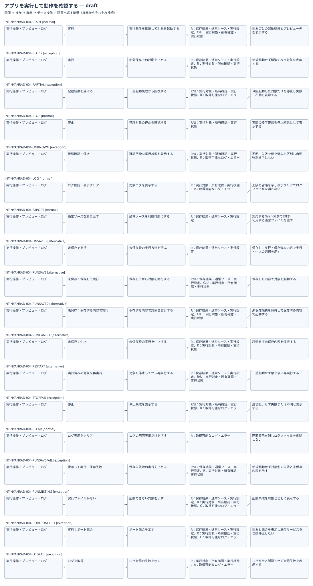

# アプリを実行して動作を確認する：IFDAM確認用初稿

| Interaction | 種別 | 条件 | 返す結果 |
|---|---|---|---|
| INT-NYANRAD-004-START | normal | 部分保存がなく未保存時の選択を解決し二重起動でない | 対象ごとの起動結果とプレビュー先を表示する |
| INT-NYANRAD-004-BLOCK | exception | 保存内容が部分保存で混在 | 新規起動せず解消すべき対象を表示する |
| INT-NYANRAD-004-PARTIAL | exception | 今回起動したサービスの一部が失敗 | 今回起動した対象だけを停止し失敗・不明も表示する |
| INT-NYANRAD-004-STOP | normal | 管理対象の所有を確認できる | 実際の終了確認を停止結果として表示する |
| INT-NYANRAD-004-UNKNOWN | exception | 所有・終了を確認できない | 不明・失敗を停止済みと区別し自動強制終了しない |
| INT-NYANRAD-004-LOG | normal | 対象からログを取得できる | 上限と省略を示し表示クリアでログファイルを消さない |
| INT-NYANRAD-004-EXPORT | normal | 対象の保存済み内容を確認できる | 対応するNyanQL群でIDE外利用する通常ファイルを渡す |

UI工程のWorkset候補を使用。正式な境界・Baselineは未成立。図は同じ構造化データから生成したSVGとMermaidソースを併記。Schema適合と要件の承認は別。
各行の条件と結果、データ操作は検討用。競合の各選択や細かな編集操作等をすべて分解した完全なInteraction一覧ではない。次の範囲確認で補完する。
