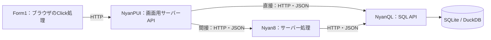

# VB6の開発体験とNyanQL群の対応案

## 目的と位置づけ

目的は「NyanQLフレームワーク群を、VB6のような統合開発環境で使えるようにすること」。
特定の業務アプリや初心者向けに対象を限定しない。ブラウザ上で部品を配置し、生成物はNyanQL群の体裁を保った編集可能なソースコードとする。

本書はDR-NYANRAD-001の追加調査・比較資料。対応、構成、コードは提案であり、正式要件・Baseline・Work Requestではない。VB6の全機能、VB言語互換、既存VB6プロジェクトの取込を採用したものではない。例のJavaScriptや配置方法も、比較を具体的にするための案である。

## 接続方式・実行環境について確認した方向

- NyanPUI・Nyan8・NyanQLを扱い、Nyan8のサーバー処理も開発環境の対象として整理する。
- NyanPUIからNyanQLへ直接接続する構成と、Nyan8を経由する構成の両方を扱えるようにする。
- NyanQL群の実行ファイルは要求者側で用意する。採用バージョン、対応OS、配置場所は別途確認する。
- DBはまずNyanQLに組み込まれているものを利用する方向。確認されたSQLite・DuckDBを検討対象とし、既定DBや初回の詳細対応範囲はまだ固定しない。

API間はJSONでデータを交換する案を基本として検討する。ただし、JSONの項目・エラー形式まで各製品で同一とは扱わない。画面のHTML配信とは区別する。

NyanRADの画面をHTML・CSS・JavaScriptで構築し、保存や実行管理をNyanQL群のサーバー側機能で支える構成は技術案。ブラウザだけで任意のファイル保存やOSプロセス管理ができるという意味ではない。IDE自身の管理データと、生成アプリが扱うDBの用途も分けて検討する。

## 1. 開発者から見た対応

| VB6で馴染みのある操作・概念 | NyanRADでの操作案 | 保存・実行の対応 | 既存基盤と追加部分 |
|---|---|---|---|
| プロジェクトの新規作成 | NyanQL群用のプロジェクトを作る | NyanKIT型の製品別フォルダ、各config.json・api.json | 既存構成を利用。新規作成・保存UIは追加 |
| プロジェクトエクスプローラー | フォーム、ブラウザ処理、サーバー処理、SQL、設定を一覧表示 | 実在するファイルへの対応を表示 | プロジェクト索引・編集画面を追加 |
| フォームの追加 | 新しい画面とURLを作る | NyanPUI/html/forms/*.html とapi.json | HTML配信は既存。フォーム生成を追加 |
| ツールボックスから配置 | 部品を置き、移動・サイズ変更する | HTMLの要素とCSS | 部品カタログ、選択、ドラッグ、整列、Undo/Redoを追加 |
| プロパティ編集 | 名前、表示文字、位置、寸法、表示・有効状態を編集 | id、textContent/value、CSS、hidden/disabled等 | プロパティとHTMLの対応規約を追加 |
| コントロールのダブルクリック | 既定イベントの処理を開く。未作成なら雛形を追加 | ブラウザ用イベントファイル | エディター、イベント索引、結線コード生成を追加 |
| コードウィンドウの対象・イベント選択 | 対象部品とClick等を選択 | 実ファイルの関数位置に移動 | コード解析と入力補完を追加 |
| 共通モジュール | 複数画面で使う関数を編集 | ブラウザ用JS、各サービスの共通JS | 実行場所を明示。GojaとブラウザのAPIを混同しない |
| DB処理 | 名前付きSQL/APIを編集し、イベントから呼ぶ | NyanQL/sql、javascript、api.json | DB実行は既存。編集・呼出支援を追加 |
| サーバー処理・外部連携 | JavaScript APIや処理を編集する | Nyan8/javascript、api.json | API・メール等は既存。統合編集を追加 |
| 実行 | 保存したソースでプレビューを開く | プロジェクトが使用するNyanPUI・Nyan8・NyanQLを起動 | 起動管理・状態表示は追加。ブラウザだけではOSプロセスを起動できない |
| 停止 | 開発環境が起動したプロセスを止める | 所有するプロセスに限定 | セッション・プロセス所有管理を追加 |
| デバッグ | エラー位置、ログ、必要に応じブレークポイントを扱う | ブラウザとGojaを別々に扱う | Goja側のVB6相当デバッガが揃うとは未確認。独立した調査対象 |
| 保存・再編集 | 画面とコードを保存し開き直す | HTML/CSS/JS/SQL/JSON | 対応範囲内の再読込、競合検出、手書き保護を追加 |
| 配布物の作成 | 実行に必要な通常ファイルをまとめる | ソース、設定、対応するフレームワーク実行ファイル | NyanRAD専用ランタイム不要を提案。配布方式は未決定 |

ここでのVB6は操作体験の手本であり、.NETのWindows Formsや任意のWindows/COM機能をそのまま移植する意味ではない。

## 2. エディター画面の構成案

- 左：ツールボックスとプロジェクト一覧。
- 中央：フォームデザイナー／コードエディターを切替。
- 右：選択したフォーム・部品のプロパティ。
- コード編集時：部品とイベントの選択欄。
- 下：エラー、実行ログ、実行中サービス。
- 上：保存、実行、停止。

表示上の「フォーム」「イベント」「SQL」は、実在するファイルと処理を編集する入口とする。NyanRAD内部だけに実行可能な定義を閉じ込めない。

## 3. １フォームを作る具体例

挨拶フォームを例にする。業務範囲を限定するためではなく、配置・プロパティ・イベント・保存・実行を一巡して説明する例である。

1. フォームForm1を追加する。
2. 入力欄txtName、ボタンcmdHello、結果表示lblMessageを置く。
3. cmdHelloの表示文字を「表示」にする。
4. cmdHelloをダブルクリックしてClick処理を書く。
5. 実行し、名前を入力して「表示」を押す。
6. 保存して開き直すと、部品の配置とイベント処理が残る。

### 生成フォルダ案

NyanKITの製品別構成に合わせる。下記のファイル名はNyanRAD側の案で、フレームワークの予約名ではない。

```text
HelloProject/
├── NyanPUI/
│   ├── config.json
│   ├── api.json
│   └── html/
│       ├── forms/Form1.html
│       ├── css/Form1.css
│       └── js/
│           ├── Form1.events.js
│           └── Form1.bindings.js
├── NyanQL/                  # DB処理を追加するとき
│   ├── config.json
│   ├── api.json
│   └── sql/hello.sql
└── Nyan8/                   # JavaScript API・処理等を追加するとき
    ├── config.json
    ├── api.json
    └── javascript/
```

挨拶だけの例はNyanPUIだけで成立する。IDEでは３製品を扱うが、個別アプリの使用サービスは構成に応じる。実行ファイルは要求者側で用意する。採用版・配置方式は未決定。

### NyanPUI/api.json

```json
{
  "Form1": {
    "html": "./html/forms/Form1.html",
    "description": "挨拶フォーム"
  },
  "assets": {
    "type": "public",
    "path": "./html"
  }
}
```

HTMLは /Form1、CSSとJSは /assets/... から配信する。明示的なpublic定義を使い、実行ファイル横のhtmlディレクトリに依存する組込 /css・/js 配信とは分ける。プロジェクト直下全体をpublicにはしない。

### NyanPUI/config.json

```json
{
  "name": "HelloProject",
  "port": 8009,
  "certPath": "",
  "keyPath": "",
  "javascript_include": [],
  "log": { "EnableLogging": false, "Level": "info" }
}
```

説明用のローカル確認設定。PUIは全インターフェースで待ち受けるため、これは公開用認証・配備設定を含むものではない。

### NyanPUI/html/forms/Form1.html

```html
<!doctype html>
<html lang="ja">
<head>
  <meta charset="utf-8">
  <meta name="viewport" content="width=device-width, initial-scale=1">
  <title>挨拶フォーム</title>
  <link rel="stylesheet" href="/assets/css/Form1.css">
  <script type="module" src="/assets/js/Form1.bindings.js"></script>
</head>
<body>
  <main id="Form1" aria-label="挨拶フォーム">
    <label id="lblName" for="txtName">名前</label>
    <input id="txtName" type="text">
    <button id="cmdHello" type="button">表示</button>
    <output id="lblMessage" aria-live="polite"></output>
  </main>
</body>
</html>
```

### NyanPUI/html/css/Form1.css

```css
#Form1 { position: relative; width: 480px; height: 240px; }
#lblName { position: absolute; left: 24px; top: 24px; }
#txtName { position: absolute; left: 24px; top: 52px; width: 240px; }
#cmdHello { position: absolute; left: 288px; top: 52px; width: 96px; }
#lblMessage { position: absolute; left: 24px; top: 112px; }
```

VB6に近い配置を説明するための固定座標例。実製品での画面幅への追従、単位、拡大縮小、アクセシビリティは別途検討する。

### NyanPUI/html/js/Form1.events.js

```javascript
// 開発者が編集するイベント処理。配置の再生成では上書きしない案。
export function cmdHello_Click() {
  const name = document.getElementById("txtName").value.trim();
  document.getElementById("lblMessage").textContent =
    name ? name + "さん、こんにちは" : "名前を入力してください";
}
```

### NyanPUI/html/js/Form1.bindings.js

```javascript
// デザイナーが管理する結線コードの案。
import { cmdHello_Click } from "./Form1.events.js";
document.getElementById("cmdHello")
  .addEventListener("click", cmdHello_Click);
```

コード例は通常のブラウザJavaScript。架空のTextプロパティやNyanRAD組込APIは使用していない。画面上では「表示文字」と編集できても、出力はHTMLと標準DOM APIになる。

実行イメージは、既存NyanPUIバイナリへ --config と --api でこの２ファイルを渡し、http://127.0.0.1:8009/Form1 を開く形。例はソース仕様と照合した説明用断片であり、バイナリによる動作検証済みサンプルではない。

## 4. DB処理とサーバー処理を追加する場合

画面とサーバー処理は実行場所が違う。一つのIDEにまとめても、この区別は表示する。



直接とNyan8経由の両方を扱う方向が示された。図はその構成案であり、既定の経路を決めたものではない。別プロセスへの呼出しにnyanCallMeは使わず、HTTPクライアント等を使う。ブラウザ生成コードへDB接続情報やサーバー間の認証情報を埋め込まない。

NyanQLのSQL定義例：

```sql
-- NyanQL/sql/hello.sql
SELECT /*name*/'guest' AS name;
```

```json
{
  "hello": {
    "sql": ["./sql/hello.sql"],
    "description": "入力した名前を返す"
  }
}
```

これはNyanQL/api.jsonの例であり、NyanPUIのapi.jsonと混ぜない。NyanPUI側にはこのAPIを呼ぶサーバー用JSとエンドポイントを追加する。接続設定、認証、例外時の応答は用途に合わせて設計するため、このSQL断片だけで画面とDBが接続済みとはしない。

## 5. 「体裁を保つ」の具体案

- 各製品に既存のconfig.json・api.json・ディレクトリを使う。
- ブラウザ用JSとサーバー用Goja JSを別ファイルとして扱う。
- 画面レイアウトをHTML/CSS、イベントをJS、DB処理をSQLとして読むことができる。
- NyanRADなしでも、対応版のNyanQL群で起動できることを確認対象とする。
- 編集補助ファイルを導入する場合も、アプリの実行には不要とする。
- 各api.jsonには既存製品で定義された項目だけを書き、IDE専用項目を混ぜない。
- 生成ファイルをGitで差分確認できる。再生成で無関係な整形差分を大量に出さない。

## 6. ソース手編集と再編集：提案と限界

推奨案は「対応するHTML/CSS/イベント結線を読み取り、手書きイベント関数は維持する」方式。

- 移動・サイズ変更は対応するHTML/CSS部分だけを書き換える。
- イベント関数は初回作成のみ。配置の更新で本文を生成し直さない。
- 名前変更ではid、CSSセレクタ、結線の対応を確認する。手書きコードの参照を無条件の文字列置換で変えない。
- 部品削除時に手書き処理を自動消去しない。未使用として示す等の方針を検討する。
- 外部エディターの変更を検知し、未保存変更と競合したら上書きを止めて差分を示す。
- 任意の動的DOM生成や複雑なCSSまで完全に逆変換できるとは約束しない。非対応部分は保存し、編集可能範囲を表示する。

別案として、編集専用モデルを正本にしてコードを一方向生成する方式もあるが、手編集後の再読込と二重管理が課題になる。今回はソース編集を中心に据える案を比較の第一候補とする。採用は未決定。

## 7. 既存機能だけでは埋まらない部分

1. デザイナー、部品カタログ、プロパティ、コード索引。
2. ソース解析・部分更新・競合検出とUndo/Redo。
3. 起動・停止・ログを扱う管理サービス。ローカル方式か共有サーバー方式かは未決定。
4. ブラウザのデバッグとGojaのデバッグを統合する方法。
5. 保存した複数ファイルを整合した状態でプレビューへ反映する方法。ホットリロードだけではプロジェクト全体の原子的な切替にならない。
6. 複数プロジェクトのポート・設定・認証情報の分離。

Nyan8の現READMEには、ホットリロード後も起動時ルートが残るケースがある旨が記載されている。実行操作は「全変更が自動反映される」とせず、変更内容に応じた再起動を扱う。

## 8. 次に比較・判断する論点

目的の聞き直しや特定業務アプリの選択を前提にはしない。まずこの対応案について、次の違いを判断できる材料にする。

- プロパティ操作はVB6風、イベントコードは通常のJavaScriptという案でよいか。
- ソースの手編集後、デザイナーが保証する再編集範囲をどこまでにするか。
- デバッガ、独自部品、既存プロジェクト取込などを初回の対象へどこまで含めるか。
- ブラウザIDEが接続する実行・保存先をローカルか共有サーバーか、どう扱うか。

この資料の確認だけで実装を開始しない。人間向け要件定義工程や正式な引渡しの代替にはしない。

## 9. 確認したソース

以下は調査時点の固定参照。採用する配布版を選定したものではない。

- [NyanQL/NyanQL README](https://github.com/NyanQL/NyanQL/blob/c86c156590d49b86537e630d524a1ee65693ea50/README.md) — `c86c156590d49b86537e630d524a1ee65693ea50`
- [NyanQL/NyanPUI README](https://github.com/NyanQL/NyanPUI/blob/ebc4ddee7dffa84fb25688cbff0ba16746d42dfd/README.md) — `ebc4ddee7dffa84fb25688cbff0ba16746d42dfd`
- [NyanQL/Nyan8 README](https://github.com/NyanQL/Nyan8/blob/88c1b37bbed0c1133933f86923834c9ae8540abf/README.md) — `88c1b37bbed0c1133933f86923834c9ae8540abf`
- [NyanQL/NyanKIT README](https://github.com/NyanQL/NyanKIT/blob/0afa7e741cd564d1ea67e74de7d7f7736da8093e/README.md) — `0afa7e741cd564d1ea67e74de7d7f7736da8093e`
- [NyanPUIのHTML応答処理](https://github.com/NyanQL/NyanPUI/blob/ebc4ddee7dffa84fb25688cbff0ba16746d42dfd/main.go#L1144)、[public配信](https://github.com/NyanQL/NyanPUI/blob/ebc4ddee7dffa84fb25688cbff0ba16746d42dfd/main.go#L2177)。
