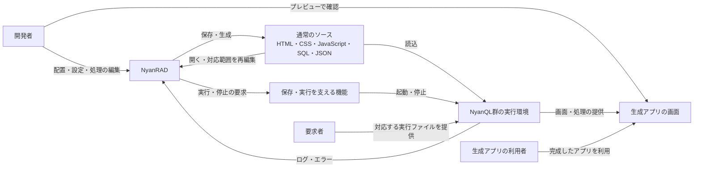
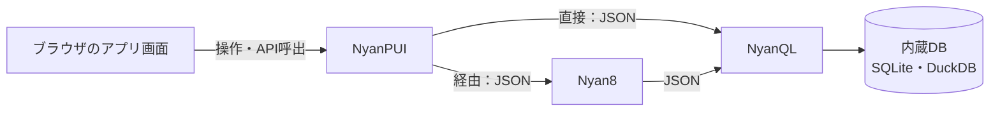

# NyanRAD 全体像（初稿）

企画確認書を材料として、関係者・生成物・実行環境と情報の流れを示す。配置先や内部実装を決める図ではない。

## 開発と利用の関係

開発者はNyanRADで作成・修正し、生成アプリの利用者はそのアプリを操作する。両者は同じ人である場合もある。
保存・実行を支える機能の提供方法は今後比較する。ブラウザ画面だけでOSプロセスを直接操作できるとは扱わない。
生成アプリの実行と、NyanRAD自身を動かす仕組みは別の検討対象である。

## 生成アプリ内の接続

直接接続とNyan8経由の両方を対象とする。常に３製品全部を使うという意味ではなく、生成アプリの構成に応じて選ぶ。
NyanPUIは画面配信等、Nyan8はサーバー処理等、NyanQLはSQL・DB処理を担う。この図は役割と経路を示し、認証・API項目・具体的な呼出コードは後工程で定める。
JSONはAPIデータ交換の基本案であり、HTMLや静的ファイルの配信までJSONに統一するものではない。
初回はSQLiteを既定とし、SQLite・DuckDBそれぞれで基本CRUDと両接続経路を確認する。

## 主な情報の流れ

| 渡すもの | 渡す元 → 受け取る先 | 内容 |
|---|---|---|
| 画面の編集内容 | 開発者 → NyanRAD → ソース | 部品、表示、配置、イベントとの対応 |
| 手書き処理 | 開発者 → ソース | 画面イベント、サーバー処理、SQL |
| 実行結果 | 実行環境 → NyanRAD・プレビュー | 画面表示、応答、ログ、エラー |
| アプリのデータ | 生成アプリ ↔ NyanQL・DB | アプリ固有の登録・参照・更新・削除 |
| 実行ファイル | 要求者 → 実行環境 | 採用版とOSに対応するフレームワーク |

ソースは人が読んで編集できる生成物として扱う。実行にNyanRAD専用定義だけを必須とする構成には閉じ込めないという案を、要件定義で具体化する。
IDEの管理情報と生成アプリのデータを混同しない。

## 未決定の境界

初回はmacOSローカル利用。保存先、実行設定、認証・権限、既存機能での実行管理の成立条件は引き続き確認する。
本番自動配備・同時編集は初回から後続へ回す検討の軸であり、本図で追加しない。

前：[企画を確認する](01-project-brief.md)／次：[大まかに区分けする](03-areas.md)
