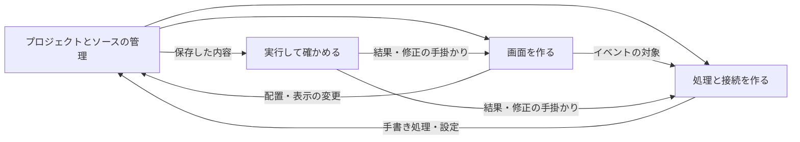

# NyanRAD 大まかな区分（初稿）

[全体像](02-overview.md)を基に、検討する役割を大まかに分ける。以下は要件定義のための区分であり、実装モジュール、画面一覧、Worksetの確定ではない。

| 区分 | 担うこと | 他の区分との関係 |
|---|---|---|
| プロジェクトとソースの管理 | プロジェクトを作り、製品別のソースと設定を開く・保存する | 全区分の編集結果を扱い、実行するソースを渡す |
| 画面を作る | フォーム、部品、配置、プロパティを編集する | 処理の編集へイベントの対象を渡し、ソースへ反映する |
| 処理と接続を作る | 画面イベント、Nyan8の処理、NyanQLのSQL・API設定を編集する | 画面とサーバー・DBを接続し、実行するソースを渡す |
| 実行して確かめる | 起動・停止、プレビュー、ログ・エラー確認を行う | 保存内容を実行し、修正の手掛かりを各編集へ返す |

## 区分間のつながり

## 全区分で整合させること

- 同じプロジェクト・部品・イベントを対応づける。
- 再配置や再生成で手書き処理を失わない範囲を定義する。
- 保存前の編集、保存済みソース、実行中の内容の違いを把握できるようにする。
- 外部でソースを変更した場合の再読込・競合の扱いを定義する。
- 画面側とサーバー側の実行場所を区別して伝える。

## 次の工程へ渡す技術論点

ブラウザから保存・実行を支える方法、既存NyanQL群の利用範囲、編集可能なソースの規約、実行ファイルの版と配置を「実装技術を決める」で比較する。
この段階で新しい機能の採用や提供範囲の変更は確定しない。

前：[全体像を描く](02-overview.md)
