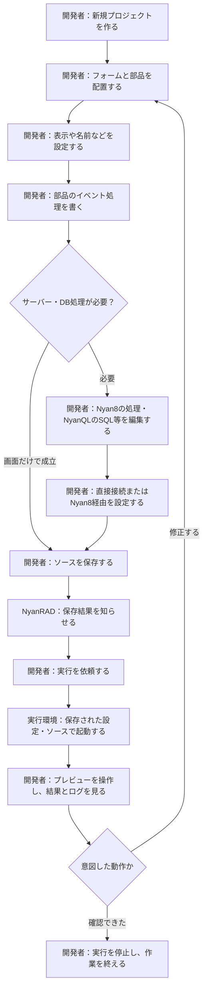
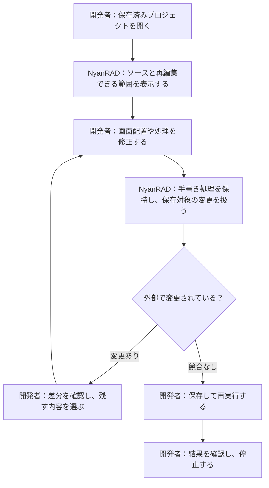

# NyanRAD 利用者の行動シナリオ（初稿）

## 誰が何をするか

開発者はmacOS上でNyanRADを使い、通常のNyanQL群のソースとしてアプリを作る。
要求者側で用意された実行ファイルを利用する。生成アプリの利用者は完成したアプリを操作する人であり、開発者と同じ人でもよい。
以下は要求一覧を具体的な仕事の流れにした案。詳細画面・Workset・機能設計はこの段階で確定しない。

## 新しいアプリを作り、動作を確認する

開発者はプロジェクトの識別情報、画面配置、処理、SQL、設定を渡す。NyanRADはそれらを保存し、保存結果と実行結果を返す。
DB処理を使う場合はアプリのデータをNyanQL経由で扱う。Nyan8を経由するか直接つなぐかはアプリに応じて選ぶ。
画面だけのアプリに、全製品の起動を必須としない。

## 保存した作業を再開し、修正する

再編集できない表現がある場合は、その範囲と残るソースを分かるようにする案。
外部変更と未保存編集が競合する場合は無条件に上書きせず、差分を判断できるようにする。自動マージの採用を決めたものではない。
手書き処理の保護・競合表示・再読込の具体的操作はUIと機能の工程で定義する。

## 失敗から作業を続ける

| 場面 | 開発者とソフトウェアのやり取りの案 | 続ける仕事 |
|---|---|---|
| 保存に失敗 | 保存できなかった対象と状態を知らせ、未保存の内容を保持する | 原因を直して保存をやり直す |
| 複数ファイルの一部だけ保存 | どこまで反映されたかを知らせる。実行可否の判断条件は後工程で定義 | 整合した保存状態へ戻してから確認する |
| 実行ファイルがない・起動できない | 対象と失敗を知らせる | ファイル・設定の場所を確認して再実行する |
| ポートが競合・実行済み | 対象プロジェクトの状態と競合を知らせる | 実行先の設定や実行状態を確認する |
| 処理やSQLが失敗 | 実行対象に対応したエラーとログを見せる | 処理を修正し、保存・再実行する |
| 実行中にアプリが終了 | 終了を知らせ、ログを確認できるようにする | 原因を修正して再実行する |
| IDEの再読込後に実行中か不明 | 状態が不明であることを示す案。再接続・停止方法は未決定 | 所有する実行対象の確認に戻る |
| 停止が完了しない | 停止完了と誤表示せず、現在分かる状態を示す | 実行対象を確認する。強制停止の操作・条件は未決定 |

これらは確認すべき結果を示す提案であり、実装済みの復旧機能ではない。
エラー時に勝手な強制停止・他サービス停止・編集内容の破棄を選ぶものではない。

## 生成ソースを通常の実行環境で使う

開発者は保存したソースと設定を取り出し、対応するNyanQL群の実行ファイルで起動する。
生成アプリの利用者はその画面を使い、アプリが定めるデータを入出力する。
この流れではNyanRAD自体の起動をアプリ実行の必須条件にしないという初回候補を具体化する。
本番自動配備や別OSへの配布まで、今回のシナリオへ追加しない。

## 要求一覧との対応

| 仕事の流れ | 対応する要求番号 |
|---|---|
| 新しいアプリを作る | 01〜12 |
| 保存して実行・確認・停止する | 02・03・04・11〜14 |
| 再開して修正する | 04〜10・15 |
| 失敗から続ける | 04・13・14・15 |
| 通常の実行環境で使う | 02・03・16 |

要求一覧の16項目は上記のいずれかへ対応する。要求番号は詳細な操作順や実装順を指定しない。

## 次の検討へ渡す情報

プロジェクト、フォーム、部品、プロパティ、イベントと処理、SQL・API設定、ソース、実行対象、保存状態、ログ・エラーが行動の中で扱われる。
次の「概念データモデルを作る」では、これらの意味と関係を整理する。DBテーブルや保存形式へ直ちに置き換えない。
未決定の管理方式、再編集の保証範囲、停止失敗・IDE再読込後の扱い、macOS対応版・CPU・ブラウザは継続管理する。

参照：[要求一覧](05-requirements-list.md)、[全体像](02-overview.md)、[macOS検証条件](04b-macos-validation.md)
