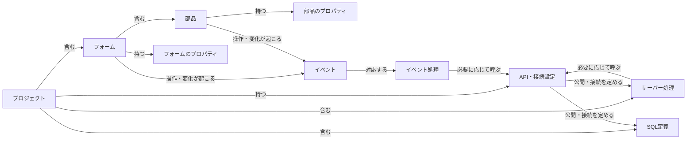
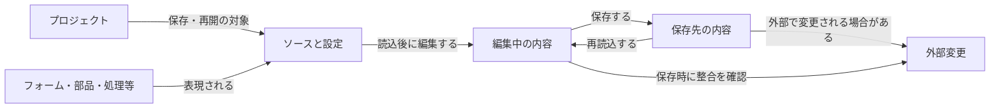
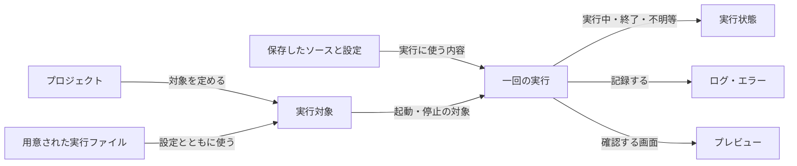

# NyanRAD 概念データモデル（初稿）

## 何を整理するか

行動シナリオに登場する情報の意味と関係を整理する。
ここでの概念は、DBテーブル、保存形式、実装クラスの指定ではない。フォームや部品の情報は通常ソースから読み取る場合もあり、別の正本データを持つことを前提にしない。

## 作るアプリの概念

| 概念 | 意味 |
|---|---|
| プロジェクト | 開発者が一つのアプリとして作成・保存・再開する作業のまとまり |
| フォーム | 開発者が配置・編集する画面。複数フォームを一つのプロジェクトで扱う |
| 部品 | フォーム上に置く入力・表示・操作等の要素 |
| プロパティ | 名前、表示文字、位置・寸法、表示・有効状態など、対象の性質 |
| イベント | 部品やフォームの操作・変化など、処理を始めるきっかけ |
| イベント処理 | イベントに対応する画面側の処理。手書き本文を保持する対象 |
| サーバー処理 | サーバー側で動く処理。Nyan8等の実行場所と対応づける |
| SQL定義 | NyanQLでデータ処理を行うSQL |
| API・接続設定 | 処理の公開先・呼出先と、各製品の接続関係を定める設定 |

イベント処理が必ずAPIを呼ぶとは限らない。画面だけで完結する処理もある。
直接接続ではNyan8の処理を必須にしない。図の矢印は候補となる関係であり、詳細な呼出規約や必須項目の確定ではない。
フォームにもプロパティとイベントがあり、部品だけへ限定しない。

## ソースと編集・保存の概念

| 概念 | 意味と区別 |
|---|---|
| ソースと設定 | HTML・CSS・JavaScript・SQL・JSON等の通常ファイル。生成物であり、手編集の対象 |
| 編集中の内容 | 現在の変更。保存済みファイルと一致しているとは限らない |
| 保存先の内容 | ファイルへ成立している内容。保存途中の失敗があれば全体の整合確認が必要 |
| 外部変更 | IDE以外で行われた変更。未保存編集と競合する可能性がある |
| 再編集の対応範囲 | IDEが読み取って画面編集へ戻せるソース表現の範囲。対応外のコードと区別する |

フォームとソースを必ず一対一にしない。一つのフォームがHTML・CSS・イベントJS等へ分かれたり、共通のソースを複数フォームが参照したりする可能性を残す。
競合を検出する版情報・ハッシュ等の方式、ソースと編集補助情報の関係は後工程で検討する。

## 実行と確認の概念

実行対象はプロジェクトと使用製品・設定・実行ファイルの対応。一回の実行は、その対象を起動して確認する一巡の概念として区別する。
プロジェクトが使用する製品は構成に応じるため、実行対象に複数のサービスが含まれる場合がある。
画面の再読込とサーバープロセスの再起動は別の操作。編集中・保存済み・実行中の内容を同一とみなさない。
実行状態を確認できない場合の「不明」は、停止済みの意味ではない。
実行記録の永続保存、PIDや開始時刻による識別等の実装方式は未決定。

## IDEの情報とアプリのデータの境界

生成アプリが扱う業務データは、ここで整理した開発プロジェクトの情報とは区別する。
NyanQLのDB接続設定は開発・実行する対象に含まれるが、接続先のデータ内容をIDEのプロジェクト管理データと同じDBへ保存する判断はしていない。
SQLite・DuckDBの採用範囲やIDE内部の保存形式を、この概念図から自動的に決めない。

## 行動シナリオとの対応

| 行動 | 主に扱う概念 |
|---|---|
| 新しいアプリを作る | プロジェクト、フォーム、部品、プロパティ、イベント、処理、SQL、設定 |
| 保存・再開・修正する | ソースと設定、編集中の内容、保存先の内容、外部変更、再編集の対応範囲 |
| 実行・確認・停止する | 実行対象、実行ファイル、一回の実行、実行状態、ログ・エラー、プレビュー |
| 失敗から続ける | 保存状態、外部変更、実行状態、エラーと対象の対応 |
| 通常環境で生成物を使う | ソースと設定、対応する実行ファイル、生成アプリのデータ |

シナリオにない共同編集者、権限組織、公開先管理等の概念は追加していない。

## 次の工程へ残す論点

フォーム・部品の名前変更や削除が、手書きコードの参照へどう影響するか。
保存結果と実行内容の対応をどこまで表示・保証するか。
再編集できないソースや競合を、利用者へどう示すか。
IDE再読込後の実行状態や停止失敗時に、何を表示し、どの操作を用意するか。

次は「UIを考える」で、行動シナリオと本モデルを材料に利用者の一つの仕事に対応する画面・動線・Worksetを具体化する。
この初稿は詳細データ要件・正式Baseline・実装開始の承認ではない。

参照：[行動シナリオ](06-action-scenarios.md)、[要求一覧](05-requirements-list.md)
