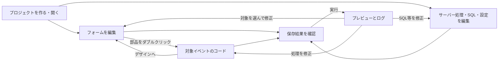

# NyanRAD UI検討（初稿）

## 操作上の残件U01〜U04の確認

要求者：「はい。この具体案で進めていいです。次進めよう。」
対象は22-operation-decisions.mdの具体案全体。以下を確認済みとして反映する。

- 競合は差分を表示し、保存先を再読込／編集内容で明示上書き／中止を選ぶ。破棄・置換する対象を示し、判断中の再変更は再確認する。
- 新規作成先に既存ファイルがある場合は生成を止め、別の場所または中止を選ぶ。既存プロジェクトは「開く」を使う。
- フォーム・部品の識別名は提案された半角英字・数字・アンダースコアの規則と重複条件を使用し、日本語の表示文字と区別する。
- 配置は整数CSSピクセル。位置は0以上、幅・高さは1以上。不正値は以前の値を保持し、はみ出しを警告して自動移動・削除しない。
- 一覧は指定行キーを使い、未指定ならその時点の行番号であることを示す。欠落・重複したキーで曖昧な結果を渡さず、再読込で選択を解除する。
- ログ表示には上限を設け、省略を表示する。「表示クリア」でログファイルを消さず、既存ログ保持設定を勝手に変更しない。

本節は同じ論点の以前の未決定表現に優先する。表示上限の具体値、内部署名・保存方式等の設計事項と、実行管理の技術成立は別途残る。
正式Baseline・受入条件全体の承認・実装開始へ読み替えない。

## 実行・停止の追加方針の確認

要求者は次の５項目に対し「はい。いいですよ。」と了承した。

1. 一部だけ保存できた状態では、新たな実行を止める。
2. 二重起動を避け、停止してから再実行する。
3. 起動に一部失敗したら、今回起動した対象だけを停止する。
4. タブを閉じただけでは自動停止を保証しない。
5. 状態不明のプロセスを自動で強制終了しない。

この節は同じ論点を以前「提案」「未決定」とした記述に優先する。
今回起動した対象の停止に失敗した場合も成功扱いせず、確認できる状態を表示する。既存の外部サービスは停止対象に含めない。
HTML・CSS・JavaScriptと要求者提供のNyanQL群実行ファイルの前提を維持する。実行管理の技術成立・動作実証、追加実行ファイルの採用、正式Baseline・実装開始は今回の了承に含めない。

実行ボタンの前段で部分保存と実行中状態を示し、起動に一部失敗したサービスごとの結果と停止結果を表示する。タブを閉じることと停止操作を区別する。

## 初回デザイナーの方針確認

要求者は「この範囲で進めてよいですか」への回答として「はい。この方針で進めて。」と明示した。
初回はVB6に近い固定座標中心の配置、基本部品とClick・Change等のイベント、通常JavaScriptによるイベント処理、表示・行選択までの一覧表を軸とする。
手編集したコードを保持し、対応外の表現がある場合は編集可能な範囲を制限する。

この節は同じ論点について以前「提案」「未決定」とした記述を更新する。詳細なDOMイベントの時機、イベント引数、コピー時の処理対応、Undo範囲、部品別の細目は未確定のまま残す。
一覧表のセル内編集・ソート・検索・ページ分割やDB自動更新まで採用した意味ではない。

## 今回確認された操作方針

要求者は次の５項目への確認に「はい。これで良いので進めてください。」と回答した。

1. 未保存で実行するときは「保存して実行」「保存済み内容で実行」「中止」を選ぶ。
2. 未保存でプロジェクト切替・再読込するときは「保存」「破棄」「中止」を選ぶ。
3. 保存競合は差分を示し、自動上書きしない。
4. 部品を削除しても手書き処理の本文は残す。
5. 保存失敗・停止失敗を成功扱いにせず、確認できる状態を示す。

この節は本文の同じ論点について「案」「未決定」とした以前の記述を更新する。未確認の詳細条件まで承認した意味ではない。
部分保存後の実行禁止、競合画面の具体的な選択肢、強制停止の提供条件、名称変更の自動修正範囲は今回の５項目に含めず、検討を続ける。

未保存時の選択を実行・切替の動線へ入れる。競合は差分確認へ進み、部品削除後に処理本文が残ることを示す。失敗と成功の表示を区別する。

## 画面ラフ

VB6のように、左のツールボックスから中央のフォームへ部品を置き、右でプロパティを変更する案。
コードとフォームは同じ作業場所で切り替え、下部で実行結果を確認する。
図は検討用であり、製品の実装済み画面や寸法・配色の確定ではない。

## 画面と操作

| 場所 | 示す情報と操作 |
|---|---|
| 上部 | 新規・開く・保存、元に戻す・やり直す、実行・停止。現在のプロジェクト、未保存の有無、実行状態を表示 |
| プロジェクト一覧 | フォーム、Nyan8の処理、NyanQLのSQL、ソースと設定を辿る |
| ツールボックス | ラベル、入力、複数行入力、ボタン、チェック、選択、一覧表を配置する |
| デザイン領域 | フォームの追加・切替、部品の選択・移動・サイズ変更・コピー・整列・削除 |
| プロパティ欄 | 対象名と編集できる項目。名前、表示文字、位置・寸法、表示・有効状態等 |
| コード領域 | 対象とイベントを選び、処理を書く。ファイル名とブラウザ／サーバー等の実行場所を表示 |
| SQL・設定編集 | 対象製品と実ファイルを示し、SQL・API・接続設定を編集する |
| 下部 | エラー、ログ、実行対象とその状態。保存状態と実行状態を別々に表示 |
| プレビュー | 実際のアプリを操作して結果を確認する。フォームの配置編集とは区別する |

専用のSQLビルダー、接続ウィザード、補完、ブレークポイント操作の追加採用はこの案で決めない。

## 主な画面の行き来

ダブルクリックした部品の既定イベントが未作成なら、処理の雛形を用意する案。
既存処理がある場合はその位置へ移動し、本文を生成し直さない。
別イベントは対象・イベントの選択欄から開く。イベントの具体的な種類は機能工程で検討する。

## 利用者の一つの仕事と画面範囲

行動シナリオと概念モデルを材料に、UIを考える工程で初めて以下のWorkset候補を置く。
正式な要件境界ではなく、機能・データを検討しながら調整する。

| 候補ID | 何をどうするか | 対応する画面・動線 | 主に対応する要求 |
|---|---|---|---|
| WS-NYANRAD-001 | プロジェクトを作成・再開する | 新規・開く、プロジェクト一覧、保存・再読込 | 02〜04・15 |
| WS-NYANRAD-002 | フォームと画面イベントを編集する | デザイン、ツールボックス、プロパティ、イベントコード | 05〜08・15 |
| WS-NYANRAD-003 | サーバー処理・SQLと接続を編集する | 製品別の処理・SQL・設定編集 | 09〜12 |
| WS-NYANRAD-004 | アプリを実行して動作を確認する | 実行・停止、プレビュー、ログ、エラー、実行状態 | 03・13・14・16 |

要求01は全体目的、要求02の通常ソース利用と要求15の手書き保護は各仕事に横断する。
同じ画面を複数の仕事が使ってよい。上記はモジュールや実装順の指定ではない。
通常ソースを取り出してIDE外で使う操作は004との関係を検討し、実行にIDEを必須とする設計へ読み替えない。

## 失敗や判断が必要なときの表示案

| 状況 | 利用者に見せる内容と次の操作 |
|---|---|
| 保存失敗 | 対象ファイルと失敗を示す。未保存表示と編集を保持し、修正後に再保存 |
| 外部変更との競合 | 編集中と保存先の違いを示す。どちらを残すか判断できるようにし、無条件に上書きしない |
| 複数ファイルの一部保存 | 保存できた対象と失敗対象を表示。実行できる条件は機能工程で具体化 |
| 再編集できない表現 | 対応範囲とソースの場所を示す。対応外部分を消さない |
| 名前変更・削除 | 影響する参照と残る手書き処理を示す案。任意コードの完全解析は保証しない |
| 起動失敗・ポート競合 | 対象製品・設定と失敗を示す。対象を確認して修正・再実行 |
| 実行状態が不明 | 「不明」と表示し、停止済みと区別。再接続や停止操作は管理方式と合わせて検討 |
| 停止失敗 | 停止完了と表示しない。分かっている実行状態とエラーを示す |

保存を伴う実行、未保存のまま別プロジェクトを開く場合、削除の確認、編集中データの破棄などの判断操作は、機能・例外条件の工程で具体化する。
今回のラフは未決定の操作を暗黙の自動実行にしない。

## 次に具体化すること

本稿を材料に「機能について考える」で操作ごとの入力・出力、状態変化、エラーと例外を定める。
その後「データについて考える」で必要なデータ項目と関係を詳しくする。
macOSの対応版・CPU・ブラウザ、実行管理の技術成立、固定座標配置の数値条件と再編集の対応表現の細則は継続管理する。固定座標中心、対応外ソース保持と編集制限の方針は確認済み。
本稿のWorksetは候補であり、正式Baselineや実装指示ではない。

参照：[行動シナリオ](06-action-scenarios.md)、[概念モデル](07-conceptual-data-model.md)、[要求一覧](05-requirements-list.md)

## 編集操作の細目への了承

要求者：「いいと思う。先進めよう。」
対象は[編集操作の細目案](https://github.com/kosaru/NyanRAD/blob/b98dd143752d2ef9f916423c6479877a1371aca4/planning/requirements/13-editing-details.md)。

コピー時に手書き本文を自動複製しない、名称変更で任意本文を文字列置換しない、配置等のUndoとコード履歴を分ける、保存後も同じ編集セッションでは履歴を保持しUndo後を未保存とする、削除Undoで本文を二重生成しない、明示的なイベント引数、Loadの時機等の検討方針を了承されたものとして記録する。
本文に明示された未決定の署名・値型・行キー・配置値の細則・履歴上限等は、この了承で自動確定させない。

詳細は13-editing-details.mdを参照。この確認節は同じ論点の以前の未確定記述を更新する。

## 2026-10-27 初回イベント処理の人間判断

要求者：「Aで進めて」。対象は[A・B比較案](https://github.com/kosaru/NyanRAD/blob/98fee5005d0cd748d998961d209b1c202324fc14/planning/requirements/24-event-handler-options.md)。Aを採用する。イベント処理が未作成なら、イベントを選んで開いたとき編集用の雛形を未保存で表示し、保存時にファイルへ反映する。開いただけでは保存済みファイルを変更せず、既存の手書き本文は勝手に再生成・上書きしない。

イベント引数の具体的な署名・値型、雛形のコード形、技術成立、正式Baseline・実装開始・リリースはこの判断で確定しない。
