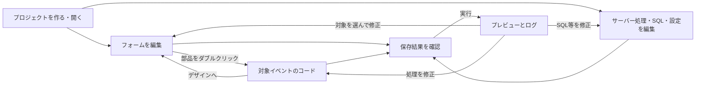

# NyanRAD UI検討（初稿）

## 画面ラフ

VB6のように、左のツールボックスから中央のフォームへ部品を置き、右でプロパティを変更する案。
コードとフォームは同じ作業場所で切り替え、下部で実行結果を確認する。
図は検討用であり、製品の実装済み画面や寸法・配色の確定ではない。

## 画面と操作

| 場所 | 示す情報と操作 |
|---|---|
| 上部 | 新規・開く・保存、元に戻す・やり直す、実行・停止。現在のプロジェクト、未保存の有無、実行状態を表示 |
| プロジェクト一覧 | フォーム、Nyan8の処理、NyanQLのSQL、ソースと設定を辿る |
| ツールボックス | ラベル、入力、複数行入力、ボタン、チェック、選択、一覧表を配置する |
| デザイン領域 | フォームの追加・切替、部品の選択・移動・サイズ変更・コピー・整列・削除 |
| プロパティ欄 | 対象名と編集できる項目。名前、表示文字、位置・寸法、表示・有効状態等 |
| コード領域 | 対象とイベントを選び、処理を書く。ファイル名とブラウザ／サーバー等の実行場所を表示 |
| SQL・設定編集 | 対象製品と実ファイルを示し、SQL・API・接続設定を編集する |
| 下部 | エラー、ログ、実行対象とその状態。保存状態と実行状態を別々に表示 |
| プレビュー | 実際のアプリを操作して結果を確認する。フォームの配置編集とは区別する |

専用のSQLビルダー、接続ウィザード、補完、ブレークポイント操作の追加採用はこの案で決めない。

## 主な画面の行き来

ダブルクリックした部品の既定イベントが未作成なら、処理の雛形を用意する案。
既存処理がある場合はその位置へ移動し、本文を生成し直さない。
別イベントは対象・イベントの選択欄から開く。イベントの具体的な種類は機能工程で検討する。

## 利用者の一つの仕事と画面範囲

行動シナリオと概念モデルを材料に、UIを考える工程で初めて以下のWorkset候補を置く。
正式な要件境界ではなく、機能・データを検討しながら調整する。

| 候補ID | 何をどうするか | 対応する画面・動線 | 主に対応する要求 |
|---|---|---|---|
| WS-NYANRAD-001 | プロジェクトを作成・再開する | 新規・開く、プロジェクト一覧、保存・再読込 | 02〜04・15 |
| WS-NYANRAD-002 | フォームと画面イベントを編集する | デザイン、ツールボックス、プロパティ、イベントコード | 05〜08・15 |
| WS-NYANRAD-003 | サーバー処理・SQLと接続を編集する | 製品別の処理・SQL・設定編集 | 09〜12 |
| WS-NYANRAD-004 | アプリを実行して動作を確認する | 実行・停止、プレビュー、ログ、エラー、実行状態 | 03・13・14・16 |

要求01は全体目的、要求02の通常ソース利用と要求15の手書き保護は各仕事に横断する。
同じ画面を複数の仕事が使ってよい。上記はモジュールや実装順の指定ではない。
通常ソースを取り出してIDE外で使う操作は004との関係を検討し、実行にIDEを必須とする設計へ読み替えない。

## 失敗や判断が必要なときの表示案

| 状況 | 利用者に見せる内容と次の操作 |
|---|---|
| 保存失敗 | 対象ファイルと失敗を示す。未保存表示と編集を保持し、修正後に再保存 |
| 外部変更との競合 | 編集中と保存先の違いを示す。どちらを残すか判断できるようにし、無条件に上書きしない |
| 複数ファイルの一部保存 | 保存できた対象と失敗対象を表示。実行できる条件は機能工程で具体化 |
| 再編集できない表現 | 対応範囲とソースの場所を示す。対応外部分を消さない |
| 名前変更・削除 | 影響する参照と残る手書き処理を示す案。任意コードの完全解析は保証しない |
| 起動失敗・ポート競合 | 対象製品・設定と失敗を示す。対象を確認して修正・再実行 |
| 実行状態が不明 | 「不明」と表示し、停止済みと区別。再接続や停止操作は管理方式と合わせて検討 |
| 停止失敗 | 停止完了と表示しない。分かっている実行状態とエラーを示す |

保存を伴う実行、未保存のまま別プロジェクトを開く場合、削除の確認、編集中データの破棄などの判断操作は、機能・例外条件の工程で具体化する。
今回のラフは未決定の操作を暗黙の自動実行にしない。

## 次に具体化すること

本稿を材料に「機能について考える」で操作ごとの入力・出力、状態変化、エラーと例外を定める。
その後「データについて考える」で必要なデータ項目と関係を詳しくする。
macOSの対応版・CPU・ブラウザ、実行管理方式、配置方式、再編集保証範囲は未決定として継続管理する。
本稿のWorksetは候補であり、正式Baselineや実装指示ではない。

参照：[行動シナリオ](06-action-scenarios.md)、[概念モデル](07-conceptual-data-model.md)、[要求一覧](05-requirements-list.md)
