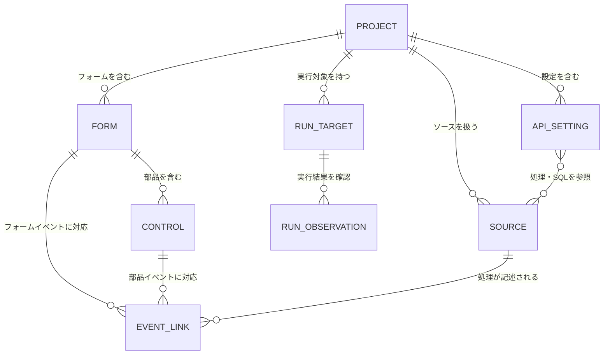

# NyanRAD データ検討（初稿）

## 初回デザイナーの方針確認

要求者は「この範囲で進めてよいですか」への回答として「はい。この方針で進めて。」と明示した。
初回はVB6に近い固定座標中心の配置、基本部品とClick・Change等のイベント、通常JavaScriptによるイベント処理、表示・行選択までの一覧表を軸とする。
手編集したコードを保持し、対応外の表現がある場合は編集可能な範囲を制限する。

この節は同じ論点について以前「提案」「未決定」とした記述を更新する。詳細なDOMイベントの時機、イベント引数、コピー時の処理対応、Undo範囲、部品別の細目は未確定のまま残す。
一覧表のセル内編集・ソート・検索・ページ分割やDB自動更新まで採用した意味ではない。

## 今回確認された操作方針

要求者は次の５項目への確認に「はい。これで良いので進めてください。」と回答した。

1. 未保存で実行するときは「保存して実行」「保存済み内容で実行」「中止」を選ぶ。
2. 未保存でプロジェクト切替・再読込するときは「保存」「破棄」「中止」を選ぶ。
3. 保存競合は差分を示し、自動上書きしない。
4. 部品を削除しても手書き処理の本文は残す。
5. 保存失敗・停止失敗を成功扱いにせず、確認できる状態を示す。

この節は本文の同じ論点について「案」「未決定」とした以前の記述を更新する。未確認の詳細条件まで承認した意味ではない。
部分保存後の実行禁止、競合画面の具体的な選択肢、強制停止の提供条件、名称変更の自動修正範囲は今回の５項目に含めず、検討を続ける。

選択した未保存時の操作、差分確認に必要な比較内容、残る手書き本文、対象別の保存結果と実行状態が機能へ渡るよう対応づける。これらの永続保存を新規要件として追加しない。

## データを定める範囲

機能初稿の入力と出力を基に、必要な情報と関係を定める案。
以下は要件上のデータ項目であり、物理DBテーブル・型・キー・保存形式の設計ではない。通常ソースを正本とする前提を維持し、同じ内容の専用定義を別の正本として追加しない。
項目の必須条件・値の制限・保持期間で未決定のものは、正式要件を固定する前に解消する。

## 必要な情報

| 情報 | 項目候補 | 何に使うか | 保存・保持の考え方 |
|---|---|---|---|
| プロジェクト | 名前、保存場所、使用製品、関連ソース・設定の対応 | 新規作成・再開・実行対象の識別 | 保存場所から再開できる必要がある。索引の保存方式は未決定 |
| フォーム | 名前、関連ソース、表示属性、配置に関する属性 | デザイン・表示・画面切替 | HTML・CSS等との対応。名前と内部識別の方式は未決定 |
| 部品 | 所属フォーム、種類、名前、表示・値、位置・寸法、表示・有効状態 | 配置・プロパティ編集 | ソースへ表す。部品別の項目と配置方式は未決定 |
| イベントとの対応 | 対象フォーム／部品、イベント名、処理の参照 | 対象・イベント選択、コードを開く | 結線と手書き本文を区別。具体的な表現は未決定 |
| 処理のソース | 所属製品、実行場所、ファイルの場所、本文、共通参照 | 画面イベント・サーバー処理の編集 | 通常JavaScript等として保存する案 |
| SQLとAPI設定 | 所属製品、SQLの場所・本文、API名、対応する処理、呼出先の設定 | SQL・API・接続編集 | 各製品の既存形式を保つ。製品間の項目を同一視しない |
| DB接続設定 | 対応するNyanQL、DB種類・接続先等の既存設定 | 内蔵DBの利用と生成アプリ実行 | 生成アプリの設定。IDE内DBの採用を意味しない |
| 編集状態 | 読込時の内容との対応、現在の本文・配置、変更の有無、再編集の対応範囲 | 未保存表示、部分更新、手書き保護 | 作業中に必要。クラッシュ後の自動復旧・永続保存は未採用 |
| 操作履歴 | 対象操作、変更前後との対応、現在の位置 | Undo／Redo | 対象操作と保存・再読込後の保持範囲は未決定 |
| 保存結果・競合情報 | 対象ファイル、読込時と保存先の比較情報、対象別成否、エラー | 競合・保存失敗・部分保存の表示 | 比較方式と複数ファイルの整合単位は未決定 |
| 実行対象 | プロジェクト、使用サービス、実行ファイル・版・設定・作業場所の対応、プレビュー先 | 起動・停止・表示 | 再設定や再開に必要な保持範囲は未決定 |
| 実行状態 | 対象、起動の識別、確認できた状態、確認時点、終了・失敗の情報、使用した保存内容との対応 | 二重起動の把握、停止、結果表示 | プロセス識別・IDE再起動後の復元方式は未決定 |
| ログ・エラー | 対象、取得元、取得できる時刻・重大度・本文、関連ファイル等 | エラー確認と修正 | 存在しない位置情報を生成しない。取得位置・期間・文字コードは未決定 |

認証情報等を表示・持出しする範囲は生成物の提供条件と合わせて決める。管理画面やログへ無条件に露出させる仕様は追加しない。
上記にない利用者管理・組織・共同編集のデータは初回へ追加しない。

## 要件上の関係図

図は関係の説明であり、英字名は物理テーブル名ではない。
EVENT_LINKはフォームまたは部品のいずれかを対象とする。両方への所属を同時に必須としない。
一つのソースに複数処理がある場合や、共通ソースを参照する場合を残す。フォームとファイルを一対一へ固定しない。
RUN_OBSERVATIONは実行を確認する情報であり、実行履歴の永続保存機能の採用ではない。

## 機能とデータのCRUD対応案

Cは作成、Rは参照、Uは更新、Dは削除を表す。保存の物理処理やDBトランザクションの指定ではない。

| 機能 | プロジェクト | フォーム・部品 | イベント・処理 | SQL・設定 | 編集状態・履歴 | 保存結果・競合 | 実行対象 | 実行状態・ログ |
|---|---|---|---|---|---|---|---|---|
| 新規作成・開く | C/R | C/R | C/R | C/R | C | — | C/R | R※ |
| フォーム・部品を追加・変更 | R | C/R/U | R | — | C/R/U | — | — | — |
| 名前変更・削除 | R | R/U/D | R/U※ | R/U※ | C/R/U | — | R/U※ | — |
| イベント・処理を編集 | R | R | C/R/U | R | C/R/U | — | — | — |
| SQL・設定を編集 | R | — | R | C/R/U | C/R/U | — | R/U | — |
| 保存 | R/U | R | R | R | R/U | C/R/U | R | — |
| 再読込・競合確認 | R | R | R | R | C/R/U※ | C/R/U | R | — |
| Undo／Redo | R | R/U※ | R/U※ | R/U※ | R/U | — | — | — |
| 実行・停止・プレビュー | R | R | R | R | R | R | C/R/U | C/R/U |
| ログ・エラー確認 | R | — | R※ | R※ | — | — | R | C/R/U |
| 通常ソースを取り出す | R | R | R | R | R | R | R | — |

※は詳細未決定または対象がある場合のみ。
新規作成のCは雛形等を作る場合で、既存プロジェクトを開くだけならR。
名前変更の参照更新範囲、Undo対象、再読込での編集中内容の破棄、実行状態の復元は未確定である。
新規作成・編集で作られる通常ソースの保存は「保存」に集約する。別途、同じ概念をDBへ複製する意味ではない。

## 作成元がない情報を残さない確認

プロジェクトは新規作成または既存ソースの読込、フォーム・部品は追加または読込、処理・SQL・設定は雛形・編集または読込から得る。
編集状態・履歴は読込と編集操作、保存結果・競合は保存処理と保存先の確認から得る。
実行対象はプロジェクト構成と実行設定、実行状態・ログは起動・停止・状態確認・ログ取得から得る。
「開く」「ログ確認」で情報が存在しない場合に、空の情報を成功した実行状態として補わない。

## 削除・保持と未決定事項

| 情報 | 削除・保持の検討 |
|---|---|
| フォーム・部品 | 削除操作の影響と手書き処理の扱いを決める。プロジェクト全体削除は新たに追加しない |
| 処理・SQL・設定 | 初回範囲の名称変更・削除との関係を確認。参照先を無条件に連鎖削除しない案 |
| 編集状態・履歴 | 再読込・切替・終了時の扱いと履歴上限を決める |
| 保存結果・競合 | 次の操作での再確認と、解消後に表示を解除する条件を決める |
| 実行状態・ログ | 停止しても実行結果とログの扱いを区別。保持期間と消去操作の要否は未決定 |
| DB内のアプリデータ | IDE管理データと分離。IDEの部品削除でDB内容を削除する仕様は追加しない |

## 次の工程で確認すること

UI・機能・データの意味を照合し、IFDAMとして正常系と主要例外系を接続する。
未保存実行・競合・削除・停止失敗の人間判断、技術選択の成立、対応環境・DB範囲・提供条件は引き続き未決定。
これらを残したまま正式Baselineや実装指示にしない。本稿はデータ要件の初稿であり、確定した物理ERDではない。

参照：[機能検討](09-functions.md)、[UI初稿](08-ui-design.md)、[概念モデル](07-conceptual-data-model.md)

## 編集操作の細目への了承

要求者：「いいと思う。先進めよう。」
対象は[編集操作の細目案](https://github.com/kosaru/NyanRAD/blob/b98dd143752d2ef9f916423c6479877a1371aca4/planning/requirements/13-editing-details.md)。

コピー時に手書き本文を自動複製しない、名称変更で任意本文を文字列置換しない、配置等のUndoとコード履歴を分ける、保存後も同じ編集セッションでは履歴を保持しUndo後を未保存とする、削除Undoで本文を二重生成しない、明示的なイベント引数、Loadの時機等の検討方針を了承されたものとして記録する。
本文に明示された未決定の署名・値型・行キー・配置値の細則・履歴上限等は、この了承で自動確定させない。

詳細は13-editing-details.mdを参照。この確認節は同じ論点の以前の未確定記述を更新する。
