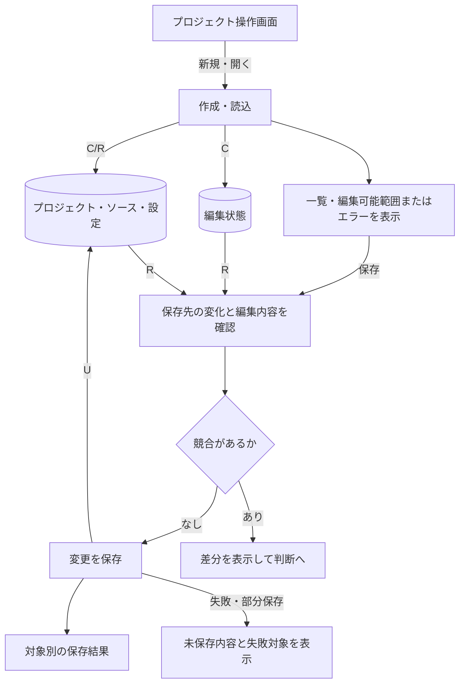
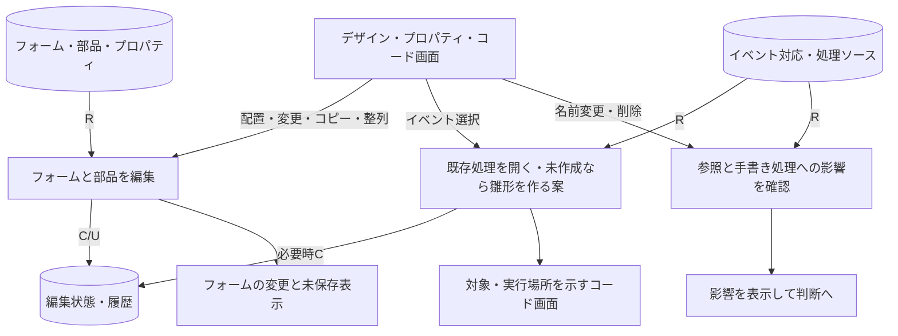
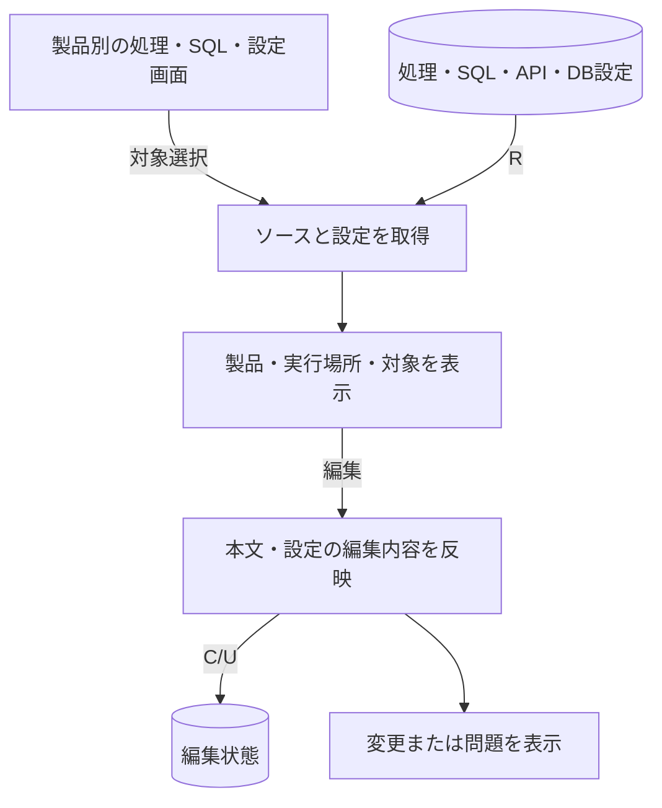
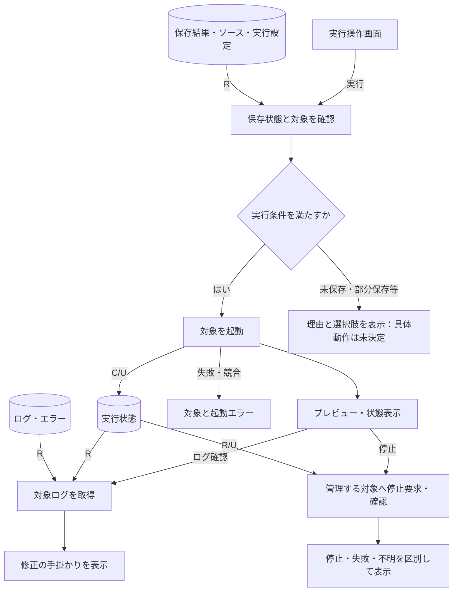

# NyanRAD UI・機能・データの接続と整合確認（初稿）

UI・機能・データの初稿をつなぐ検討用の図。正式なIFDAM Package・Schema検証済み成果物ではない。
Rは参照、Cは作成、Uは更新、Dは削除。データは物理DBテーブルに限定しない。

## プロジェクトの作成・再開・保存

部分保存後の実行条件、競合解消の選択肢、未保存で切替・再読込する動作は未決定。

## フォーム・イベントの編集

Undo／Redoは編集状態・履歴を参照更新し結果を表示する。保存は前図へつながる。
削除時のDと参照のUは対象範囲を決めてから定義する。手書き本文の連鎖削除を確定しない。

## サーバー処理・SQL・接続の編集

直接接続／Nyan8経由を扱う。生成アプリのDB処理とIDE管理データを区別する。
検査範囲、自動結線、認証情報の入力・持出しは未決定。

## 実行・確認・停止

通常ソースの持出しは保存済みソース・設定を参照し、出力結果を返す。出力形式・実行ファイル同梱は未決定。
所有追跡、再接続、強制停止も未決定。状態不明を停止済みへ変換しない案。

## 要求との対応確認

| 要求番号 | 対応先 |
|---|---|
| 01〜03 | 全図に横断する目的・通常ソース・macOSローカル条件 |
| 04 | プロジェクト作成・読込・保存 |
| 05〜08 | フォーム・プロパティ・イベント、Undo／Redo |
| 09〜12 | 製品別処理・SQL・設定・接続 |
| 13・14 | 実行・プレビュー・状態・ログ・停止 |
| 15 | 手書き保護・編集状態・競合 |
| 16 | 通常ソースの持出しとIDE外利用 |

要求16項目に対応先があることを確認。ただし詳細条件の決定や技術検証の完了を意味しない。

## 残った不足

未保存・部分保存・競合時の動作、削除・名称変更と参照更新、コピー・Undoの範囲、再編集保証、配置方式・イベント種類が未確定。
macOS対応版・CPU・ブラウザ、配布バイナリ版、DB対応範囲、実行管理の技術成立、期限・予算・ライセンス・受入条件も未確定。
次は[判断・解消一覧](11-open-decisions.md)を基に具体化する。

初稿一式が揃った段階であり、要件定義完了・正式Baseline・実装開始ではない。
参照：[UI](08-ui-design.md)、[機能](09-functions.md)、[データ](10-data.md)
