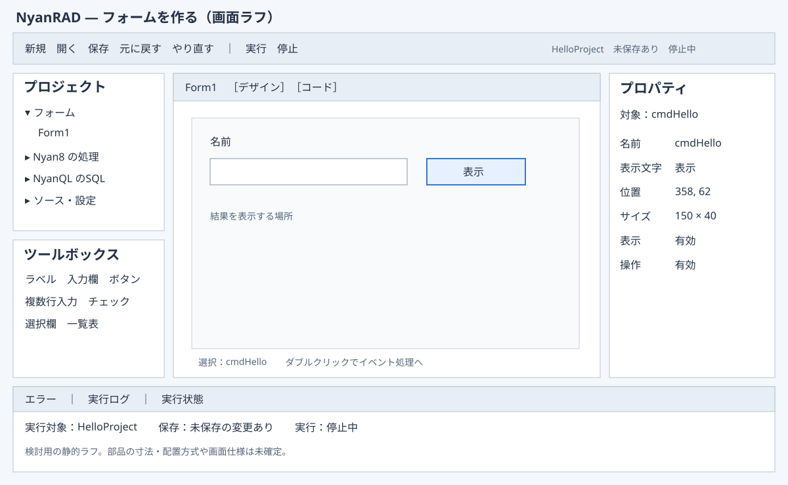

# NyanRAD 初期版の統合確認資料

作成日：2026-10-27
確認元：`7a44a4d73d8aceb1f3b6c70aa3e7ebd749392ff0`
状態：確認用初稿。既存合意を整理したものであり、新しい正式Baselineではない。

## 作るもの

NyanQL群でアプリを作る開発者が、ファイルを個別に編集する手間を減らし、画面作成から実行まで一つの環境で進められるようにする。
VB6のようにフォームへ部品を置き、プロパティを変更し、イベントからコードを開く。
生成物は通常のHTML・CSS・JavaScript・SQL・JSON等のソースと設定で、NyanQL群の体裁を保つ。特定業務や初心者向けに限定しない。

## 構築と利用の前提

NyanRADはHTML・CSS・JavaScriptで構築する。ブラウザで画面を操作し、提供されるNyanQL群実行ファイルの上で動くJavaScriptから保存等の能力を使う。
初回はmacOSのローカル利用。リモートサービスの利用はNyanQL群側で扱う。
要求者がNyanPUI・Nyan8・NyanQLの実行ファイルを用意する。新たな専用管理バイナリ・OS別外部スクリプトの必須化は採用していない。
ブラウザだけでOSプロセス管理が完結するとは扱わない。既存能力の不足があれば提示し、構築言語や追加依存を独断で変更しない。

## 初回の開発の一巡

1. プロジェクトを作成または開き、製品別のソースと設定を辿る。
2. 複数フォームを追加・切替し、部品の配置・寸法・プロパティを編集する。
3. 部品のイベント処理、サーバー処理、SQLと設定を書く。
4. ソースを保存し、実行・プレビュー・ログで結果を確認する。
5. 停止し、修正する。保存後に開き直して再編集する。
6. 通常ソースを取り出し、対応するNyanQL群でNyanRAD外からも実行する。

### 画面と編集範囲

左にプロジェクト・ツールボックス、中央にフォーム／コード、右にプロパティ、下にログ・エラー・実行状態を置く初稿。
初回は固定座標中心。基本部品はラベル、入力欄、複数行入力、ボタン、チェック、選択欄、一覧表を軸とする。
Click・Change等のイベントを対象とし、処理は通常JavaScript。フォームLoadの考え方、コピー・Undo等の確認方針は後述の通り。
一覧表は表示と行選択まで。セル内編集・ソート・検索・ページ分割・DB自動更新を自動的に初回範囲へ含めない。

### ソースと手書き処理

対応する表現はデザイナーへ読み戻す。非対応・解析不能な部分は保持し、編集可能な範囲と理由を示す。
任意HTML・CSS・実行時DOMの完全逆変換は保証しない。解析失敗を空フォームへの置換として保存しない方針。
部品のコピーでは新しい名前を用意し、元の手書き本文を自動複製しない。
名称変更ではIDE管理の識別・配置・結線の対応を更新し、任意の本文参照を無条件の文字列置換で直さない。
部品を削除しても手書き本文は残す。Undoで部品・管理する結線を戻すときに本文を二重生成しない。

### 編集履歴とイベント

Undo／Redoは配置・寸法・プロパティ・追加・削除・整列・名称変更を対象とする方針。
コード編集の履歴とは分ける。同じ編集セッションの保存後も履歴を保持し、再読込・切替で区切る。Undo後は必要に応じ未保存となり、保存済みファイルを勝手に巻き戻さない。
イベントへ渡す情報は明示する。Loadは対象DOMとIDE管理の結線が利用可能になった後に一度呼ぶ案を了承済み。全画像の読込や任意の非同期処理完了とは同一視しない。
署名・値型・行キー等の細則は残件表で扱う。

## 保存と実行の選択

| 場面 | 確認済みの扱い |
|---|---|
| 未保存で実行 | 保存して実行／保存済み内容で実行／中止を選ぶ |
| 未保存で切替・再読込 | 保存／破棄／中止を選ぶ |
| 保存競合 | 差分を示し、自動上書きしない |
| 一部だけ保存 | 新たな実行を止め、結果を対象別に表示する |
| 保存・停止失敗 | 成功扱いにせず、分かる状態を示す |
| 二重起動 | 避けて、停止してから再実行する |
| 一部サービスの起動失敗 | 今回起動した対象だけを停止する。外部サービスを停止しない |
| タブ終了 | それだけで自動停止を保証しない |
| 実行状態不明 | 停止済みと区別し、自動で強制終了しない |

編集内容・保存先・実行中の内容は区別する。ホットリロードがあるだけで全変更反映済みとは扱わない。
管理するプロセスの識別、常駐起動、停止確認、ログ取得は技術成立をまだ確認していない。了承された利用上の結果と、実現済みの能力を混同しない。

## サーバー処理・DB

Nyan8の処理、NyanQLのSQL・API・接続設定を編集する。
NyanPUI→NyanQLと、NyanPUI→Nyan8→NyanQLの両構成を扱う。個別アプリで全製品の常時利用を必須としない。
SQLiteを既定DBとする。SQLite・DuckDBそれぞれで登録・参照・更新・削除を、両接続経路で確認する。
同じSQL本文の両DB互換、DB間変換、自動初期化・移行は初回へ追加しない。
生成アプリのDBデータとIDE管理情報を区別する。NyanRAD内部へDBを必須導入する判断ではない。

## 初回から後続へ回す検討の軸

VB言語・既存VB6取込・COM／ActiveX互換、高度なブレークポイントデバッガ、任意ソースの完全逆変換、独自部品の拡張配布、同時編集・組織管理、本番自動配備・クラウド運用、外部DB向け専用支援。
これらを通常ソースで手書きできる場合と、IDEの専用操作として支援する場合を区別する。

## 完成を確認する観点と未完了事項

[受入条件案](18-acceptance-criteria.md)は、上記の一巡、手書き保持、競合・失敗時の動作、両DB・両経路、IDE外実行を確認する観点を整理している。
この資料の整理によって受入条件案全体の正式承認が済んだとはしない。
[残件の分類](21-remaining-items.md)に、利用者の動作の判断、技術設計・検証、提供条件、正式な資料整備を分けた。

## 元資料との対応

| 本資料の内容 | 主な元資料 |
|---|---|
| 目的・初期範囲 | [企画](01-project-brief.md)、[要求一覧](05-requirements-list.md) |
| 関係者・作業の流れ | [全体像](02-overview.md)、[シナリオ](06-action-scenarios.md) |
| データ・画面・機能 | [概念モデル](07-conceptual-data-model.md)、[UI](08-ui-design.md)、[機能](09-functions.md)、[データ](10-data.md) |
| 編集範囲・細目 | [部品等](12-designer-editing-options.md)、[編集操作](13-editing-details.md) |
| 構築言語と実行 | [構成](15-web-source-architecture.md)、[実行・停止](16-run-lifecycle.md) |
| DB・確認条件 | [DB範囲](17-database-scope.md)、[受入条件案](18-acceptance-criteria.md) |
| 判断の根拠 | [判断履歴](../requests/DR-NYANRAD-001/decision-log.md) |

本資料は確認済み内容の読みやすい入口。正式承認の際は、候補範囲・固定Snapshot・構造化成果物・対応表をそろえ、判断対象Commitを別途固定する。
